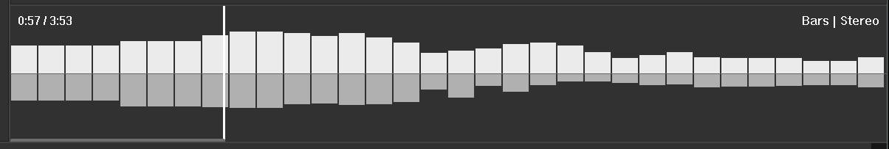
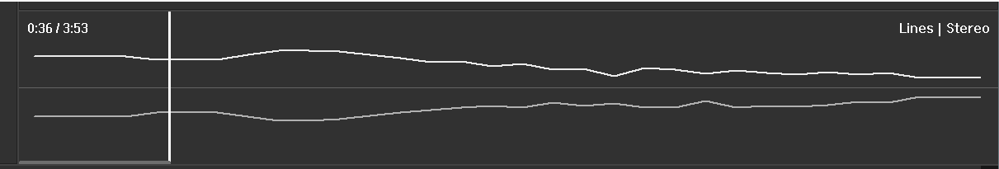
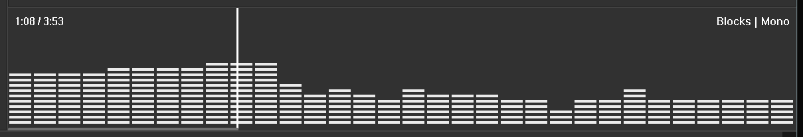
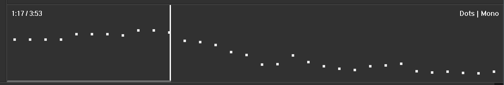

# Spectrum Seekbar for foobar2000

**Spectrum Seekbar** (`foo_spectrum_seekbar_v10`) is a native C++ UI element for
the [foobar2000](https://www.foobar2000.org/) music player that combines a
seekbar with a live spectrum analyzer. The whole width of the element is the
track timeline: click or drag anywhere to seek, while the spectrum of the
current audio is drawn behind the position marker.

Current release: **10.0.0** (Windows, 64-bit foobar2000 2.x).



## Features

- **Four visualization styles**: Lines, Bars, Blocks and Dots.
- **Two channel modes**: Mixed (mono) or Stereo (left and right channels
  mirrored around the centre line). All eight combinations are available.
- **Seeking**: left-click to jump to a position, or hold the button and drag.
- **Overlay**: elapsed / total time, the active style and mode, a progress
  bar and a position marker.
- **Right-click menu** to switch style and channel mode; the choice is saved
  with the layout.
- **Layout editing friendly**: in layout editing mode the right-click is
  passed to foobar2000, so the element can be cut, copied, pasted and
  replaced like any other element.
- **Smooth rendering**: 32-band spectrum from the foobar2000 visualisation
  API, refreshed about 60 times per second (16 ms timer) with double-buffered
  drawing.

## Screenshots

### Lines style (stereo)


### Bars style (stereo)


### Blocks style (mono)


### Dots style (mono)


## Installation

1. Download [`foo_spectrum_seekbar_v10-10.0.0.fb2k-component`](foo_spectrum_seekbar_v10-10.0.0.fb2k-component).
2. If an older version of the component is installed, remove it first in
   *File > Preferences > Components*.
3. In *File > Preferences > Components* click *Install...*, select the
   downloaded file and restart foobar2000 (or double-click the file).
4. Enable *View > Layout > Enable layout editing mode* and add the
   **Spectrum Seekbar V10** element (listed under visualisations) to your
   layout.

The published 10.0.0 package already includes the fix from commit
[`50aaa3b`](https://github.com/veselyvaclavcz/foobar-spectrum-seekbar/commit/50aaa3b)
("Fix layout edit mode and Cut operation crash"): layout editing support,
no crash on Cut/Copy/Paste, saved visualization settings and safer cleanup.

## Usage

| Action | Result |
| --- | --- |
| Left-click | Seek to that position |
| Left-click and drag | Scrub through the track |
| Right-click | Menu: *Visualization Style* (Lines / Bars / Blocks / Dots) and *Channel Mode* (Mixed (Mono) / Stereo (Mirrored)) |

## Building from source

Requirements:

- Windows with Visual Studio 2022 or the VS 2022 Build Tools (MSVC v143 x64
  toolset, Windows 10/11 SDK).
- The **foobar2000 SDK 2025-03-07**, downloaded from
  <https://www.foobar2000.org/SDK>. The SDK is not included in this repository.

Steps, from a *Developer Command Prompt for VS 2022* (or any shell where
`msbuild` is on the `PATH`) in the repository root:

1. Extract the SDK so that `SDK-2025-03-07\foobar2000\SDK\foobar2000.h` exists
   inside the repository folder (the folder is ignored by git), **or** keep it
   anywhere and pass its path with `-p:Fb2kSdk=...`.
2. Build:

   ```bat
   :: SDK extracted to .\SDK-2025-03-07
   msbuild foo_spectrum_seekbar.vcxproj -p:Configuration=Release -p:Platform=x64 -m

   :: SDK somewhere else
   msbuild foo_spectrum_seekbar.vcxproj -p:Configuration=Release -p:Platform=x64 -m -p:Fb2kSdk=C:\path\to\SDK-2025-03-07
   ```

The project builds the required SDK libraries (`pfc`, `foobar2000_SDK`,
`shared`, `foobar2000_component_client`) automatically through project
references, then the component.

Output:

| File | Description |
| --- | --- |
| `build\x64\Release\foo_spectrum_seekbar_v10.dll` | The component DLL |
| `build\foo_spectrum_seekbar_v10-10.0.0.fb2k-component` | Installable package (zip containing the DLL) |

## Repository contents

| Path | Contents |
| --- | --- |
| [`spectrum_seekbar_v10.cpp`](spectrum_seekbar_v10.cpp) | Complete source code of the component |
| [`foo_spectrum_seekbar.vcxproj`](foo_spectrum_seekbar.vcxproj) | Visual Studio / MSBuild project |
| [`foo_spectrum_seekbar_v10-10.0.0.fb2k-component`](foo_spectrum_seekbar_v10-10.0.0.fb2k-component) | Ready-to-install release package |
| [`screen/`](screen/) | Screenshots |
| [`LICENSE`](LICENSE) | MIT License |

## Version history

- **10.0.0**: four visualization styles, mono/stereo modes and the
  right-click menu; includes the layout editing and Cut/Copy/Paste crash fix
  from commit `50aaa3b`.

## License

The source code of Spectrum Seekbar is released under the [MIT License](LICENSE).

Third-party: building requires the foobar2000 SDK by Peter Pawlowski, which is
**not included** in this repository and is distributed under its own license
(see the license file included in the SDK download).
